### RynnUnify

<p align="center">
  <picture>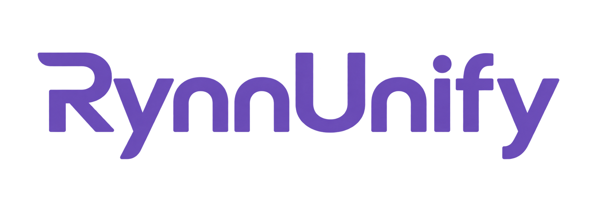</picture><br>
  <strong><em>Agentic Embodied Intelligence via Reciprocal VLM Reasoning and World Modeling</em></strong>
</p>

<p align="center">
  <picture></picture> <a href="https://alibaba-damo-academy.github.io/RynnUnify.github.io/"><b>Project Page</b></a> &nbsp;&nbsp;|&nbsp;&nbsp;
  <picture></picture> <a href="https://huggingface.co/collections/Alibaba-DAMO-Academy/rynnunify"><b>Hugging Face</b></a> &nbsp;&nbsp;|&nbsp;&nbsp;
  <picture></picture> <a href="https://www.modelscope.cn/collections/DAMO_Academy/RynnUnify"><b>ModelScope</b></a> &nbsp;&nbsp;|&nbsp;&nbsp;
  <picture></picture> <b>arXiv</b> &nbsp;&nbsp;|&nbsp;&nbsp;
  <picture></picture> <a href="RynnUnify.pdf"><b>Paper</b></a>
</p>

## Introduction

We present **RynnUnify**, a **Mixture-of-Transformers** architecture with an autoregressive **Reasoner** and a rectified-flow video **Generator**. Built on Cosmos3, RynnUnify connects embodied understanding, spatial grounding, and long-horizon visual planning through interleaved video-language reasoning.

- **Unified Embodied Brain.** RynnUnify brings embodied cognition, spatial grounding, and video generation into one architecture, connecting scene understanding with predictions of how the physical world evolves.
- **Interleaved Visual Planning.** RynnUnify alternates subtask reasoning with video prediction, using each generated outcome to plan the next step. Cross-chunk scene memory, self-forcing training, and adaptive durations support coherent visual planning over long horizons.
- **Agentic Interleaved Thinking.** An RL-trained agent learns when to answer directly and when to generate visual evidence. Through BCPO, it learns to formulate generation requests, interpret predicted outcomes, and select the reasoning path that benefits the task.
- **Connect Prediction to Action.** The World-Action Model (**WAM**) extension translates predictive world representations into robot control through joint video-action training, supporting composite manipulation tasks.

<p align="center">
  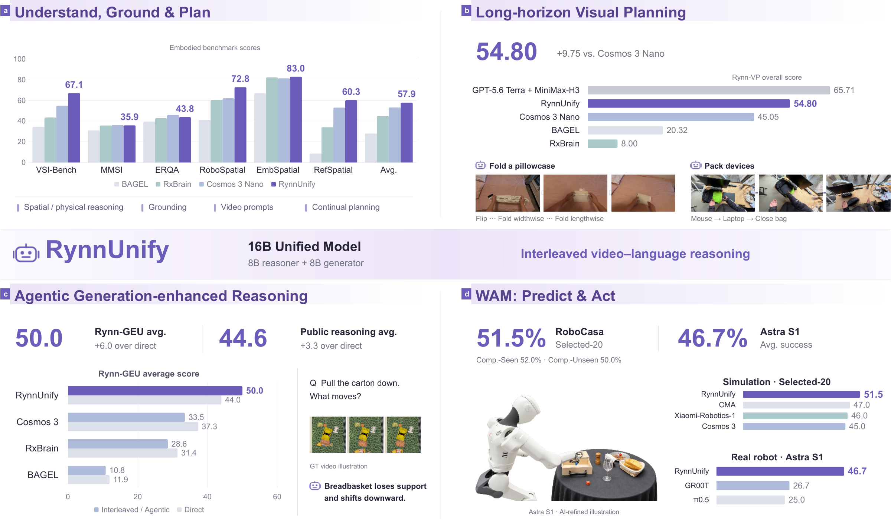
</p>

## Model Architecture

RynnUnify adopts a **16B unified embodied model** comprising an 8B autoregressive reasoner and an 8B video generator. The Reasoner predicts the next subtask, visual description, and duration. Through **joint attention**, the Generator attends to the Reasoner’s representations and predicts a video segment conditioned on scene memory and recent motion.

<p align="center">
  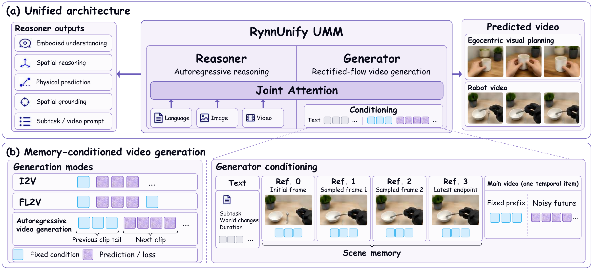
</p>

## Agentic Interleaved Thinking

Agentic interleaved thinking enhances embodied reasoning by using world modeling to imagine future scene dynamics and bring the resulting visual evidence into the reasoning process. We introduce **Branch-Conditional Policy Optimization (BCPO)** to learn both reasoning behavior and generator invocation.

BCPO samples four direct and four generation-assisted trajectories for each routable question. Within-branch reward comparisons improve reasoning behavior; differences between branch rewards supervise the routing policy. At inference time, the agent selects a branch from the original input and optionally requests generated visual evidence before answering. Only the agent is updated during training; the generator remains frozen.

<p align="center">
  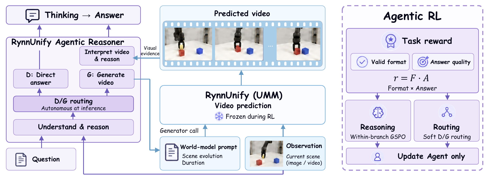
</p>

See the [algorithm](BCPO/docs/algorithm.md), [reward definitions](BCPO/docs/rewards.md), and [service interfaces](BCPO/docs/services.md).

## Performance

- Embodied Understanding and Reasoning

<p align="center"><i>General Embodied Understanding</i></p>
<p align="center">
  <a href="assets/performance/embodied-understanding.png">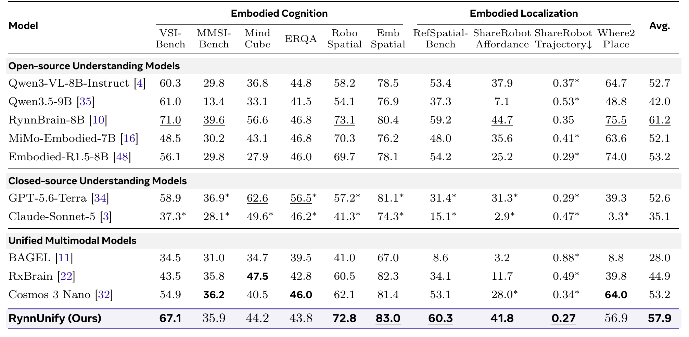</a>
</p>

<p align="center"><i>Interleaved Thinking on Public Benchmarks and Rynn-GEU</i></p>
<p align="center">
  <a href="assets/performance/agentic-interleaved-thinking.png">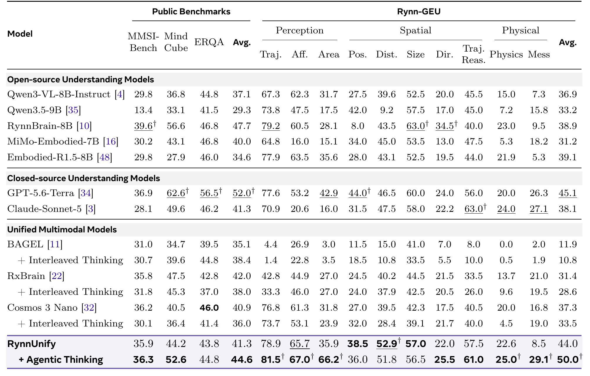</a>
</p>

- Visual Planning

<p align="center"><i>Long-horizon Visual Planning on Rynn-VP</i></p>
<p align="center">
  <a href="assets/performance/visual-planning.png">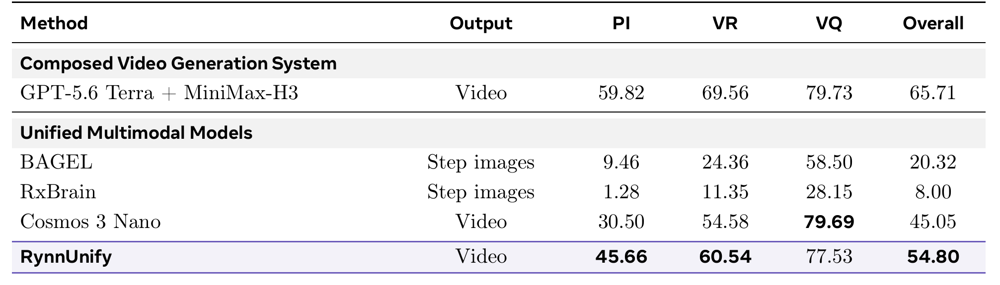</a>
</p>

<p align="center"><i>Visual Planning Visualizations</i></p>
<p align="center">
  <a href="assets/visual-planning.png">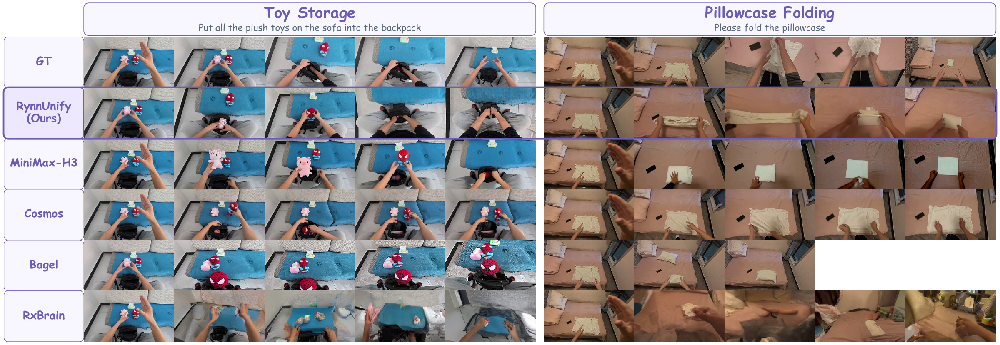</a>
</p>

- World-Action Modeling

<p align="center"><i>Robot Manipulation on RoboCasa365</i></p>
<p align="center">
  <a href="assets/performance/robocasa365.png">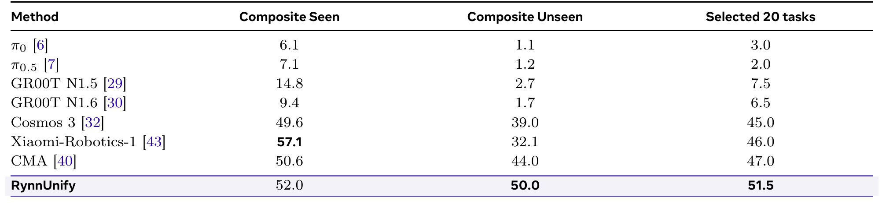</a>
</p>

<p align="center"><i>Real-Robot Evaluation on Astribot S1</i></p>
<p align="center">
  <a href="assets/performance/real-robot.png">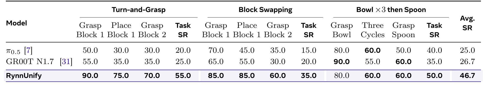</a>
</p>

<p align="center"><i>Real-Robot Execution Examples</i></p>
<p align="center">
  <a href="assets/real-robot-qualitative.png">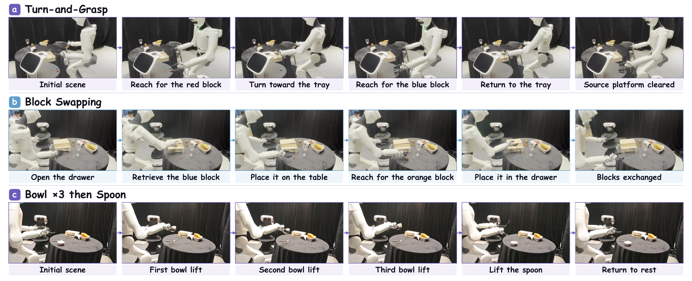</a>
</p>

---

## Model Zoo

| Model | Base Model | HuggingFace | ModelScope |
| :--- | :--- | :---: | :---: |
| RynnUnify-Base | Cosmos3 Nano | [Link](https://huggingface.co/Alibaba-DAMO-Academy/RynnUnify-Base) | [Link](https://www.modelscope.cn/models/DAMO_Academy/RynnUnify-Base) |
| RynnUnify-Agentic-Reasoner | RynnUnify-Base | [Link](https://huggingface.co/Alibaba-DAMO-Academy/RynnUnify-Agentic-Reasoner) | [Link](https://www.modelscope.cn/models/DAMO_Academy/RynnUnify-Agentic-Reasoner) |
| RynnUnify-WAM-RoboCasa | RynnUnify-Base | [Link](https://huggingface.co/Alibaba-DAMO-Academy/RynnUnify-WAM-RoboCasa) | [Link](https://www.modelscope.cn/models/DAMO_Academy/RynnUnify-WAM-RoboCasa) |

## Quick Start

Run each workflow from the repository root. Use separate environments for Agentic RL and Visual Planning, with Linux, CUDA-compatible PyTorch and compatible checkpoints.

### SFT Training

Please refer to [RynnScale](https://github.com/alibaba-damo-academy/RynnScale) for Reasoner SFT and [cosmos-framework](https://github.com/NVIDIA/cosmos-framework) for Generator training.

### Agentic RL (BCPO)

Install the BCPO package in a separate environment:

```bash
cd BCPO
python3 -m venv .venv
source .venv/bin/activate
python -m pip install -e '.[train,eval,serve]'
```

Prepare a compatible Reasoner checkpoint, [training/evaluation JSONL](BCPO/docs/data.md), and a frozen Generator service. Start a Judge service for `text` / `mess` tasks; see [service setup](BCPO/README.md#deployment). Then train and evaluate:

```bash
CUDA_VISIBLE_DEVICES=0 \
REASONER_MODEL=/path/to/reasoner \
TRAIN_DATA=/path/to/train.jsonl EVAL_DATA=/path/to/eval.jsonl \
GENERATOR_URL=http://127.0.0.1:18900/generate_video \
JUDGE_URL=http://127.0.0.1:8001/v1 JUDGE_MODEL=judge \
RUN_DIR=runs/bcpo BATCH_SIZE=1 bash scripts/train_and_evaluate.sh
```

Use a new `RUN_DIR` for each run. The script validates data, trains the Reasoner, then evaluates `train/final/` and writes results to `eval/`. Omit the Judge variables for tasks that do not need it. Start with `BATCH_SIZE=1` and adjust for available memory; each question produces eight trajectories. See [training options](BCPO/docs/training.md).

### Visual Planning Inference

Prepare the compatible Cosmos framework, a checkpoint with a visual Reasoner, and an episode JSONL with your input images. See [setup and data format](VisualPlan/README.md).

```bash
cd VisualPlan
CHECKPOINT_PATH=/path/to/compatible/hf_export \
TEST_DATA=/path/to/episodes.jsonl \
OUTPUT_DIR="$PWD/outputs/demo" \
NPROC_PER_NODE=1 bash run_interleave.sh
```

Add `DRY_RUN=1` to inspect the command without loading models. Results include generated clips, a stitched rollout and JSON summaries.

### Embodied Understanding Evaluation

Please refer to [RynnScale](https://github.com/alibaba-damo-academy/RynnScale) for embodied understanding and reasoning evaluation using the Reasoner from RynnUnify-Base, and to the [BCPO evaluation guide](BCPO/docs/evaluation.md) for Agentic Interleaved Thinking evaluation.

---

## Citation

```bibtex
@article{damo2026rynnunify,
  title={RynnUnify: Towards Unified Embodied Brain},
  author={Minghao Zhu and Bohan Hou and Kun Xiang and
          Zixuan Wang and Yinzhou Tang and Yifei Yang and
          Zhikai Wang and Tianyi Zhang and Kehan Li and
          Haoyu Zhao and Siteng Huang and Leigang Qu and
          Sicong Leng and Dongchi Huang and Mingxiu Chen and
          Shijian Lu and Yue Wang and Xiaodan Liang and
          Zhenyu Zeng and Deli Zhao and Chengju Liu and
          Jianfei Yang and Xin Li},
  journal={arXiv preprint arXiv:2610.32965},
  year={2026},
  url={https://arxiv.org/abs/2610.32965}
}
```

<details open><summary>💡 Some other multimodal-LLM projects from our team may interest you ✨. </summary><p>

> [**RynnBrain: Open Embodied Foundation Models**](https://github.com/alibaba-damo-academy/RynnBrain) <br>
> Ronghao Dang, Jiayan Guo, Bohan Hou, Sicong Leng, Kehan Li, Xin Li et al. <br>
[](https://github.com/alibaba-damo-academy/RynnBrain)  [](https://github.com/alibaba-damo-academy/RynnBrain) [](https://arxiv.org/abs/2602.14979) <br>

> [**RynnScale**](https://github.com/alibaba-damo-academy/RynnScale) <br>
> RynnScale Team <br>
[](https://github.com/alibaba-damo-academy/RynnScale)  [](https://github.com/alibaba-damo-academy/RynnScale) <br>

> [**RynnEC: Bringing MLLMs into Embodied World**](https://github.com/alibaba-damo-academy/RynnEC) <br>
> Ronghao Dang, Yuqian Yuan, Yunxuan Mao, Kehan Li, Jiangpin Liu, Zhikai Wang, Fan Wang, Deli Zhao, Xin Li <br>
[](https://github.com/alibaba-damo-academy/RynnEC)  [](https://github.com/alibaba-damo-academy/RynnEC) [](https://arxiv.org/abs/2508.14160) <br>

> [**RynnVLA-002: A Unified Vision-Language-Action and World Model**](https://arxiv.org/abs/2511.17502) <br>
> Jun Cen, Siteng Huang, Yuqian Yuan, Kehan Li, Hangjie Yuan, Chaohui Yu, Bohan Hou, Yuming Jiang, Jiayan Guo, Xin Li, Hao Luo, Fan Wang, Deli Zhao, Hao Chen <br>
[](https://github.com/alibaba-damo-academy/RynnVLA-002)  [](https://github.com/alibaba-damo-academy/RynnVLA-002)  [](https://arxiv.org/abs/2511.17502) <br>

> [**RynnWorld-4D: 4D Embodied World Models for Robotic Manipulation**](https://arxiv.org/abs/2607.06559) <br>
> Haoyu Zhao, Xingyue Zhao, Siteng Huang, Xin Li, Deli Zhao, Zhongyu Li <br>
[](https://github.com/alibaba-damo-academy/RynnWorld-4D)  [](https://github.com/alibaba-damo-academy/RynnWorld-4D)  [](https://arxiv.org/abs/2607.06559) <br>

</p></details>

## Acknowledgements

RynnUnify builds on [cosmos-framework](https://github.com/NVIDIA/cosmos-framework), [RynnBrain](https://github.com/alibaba-damo-academy/RynnBrain), and [Relax](https://github.com/redai-infra/Relax). We thank the teams behind these projects for their open-source contributions.

For development checks and contribution guidelines, see the [contributing guide](CONTRIBUTING.md). If your work is used in RynnUnify but has not been acknowledged, feel free to let us know ❤️.

## License

Project-authored code and documentation use [Apache-2.0](LICENSE). Existing **VisualPlan** source headers specify [OpenMDW-1.1](VisualPlan/LICENSE), and **BCPO** retains its [Apache-2.0 license](BCPO/LICENSE). Model weights, datasets, and manuscript figures have separate rights. See the [third-party notices](THIRD_PARTY_NOTICES.md).
